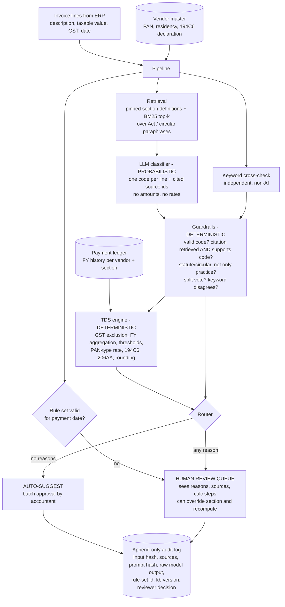

# Architecture

## Flow for one invoice

## Where each kind of knowledge lives

| Knowledge | Lives in | Why | When it goes stale |
|---|---|---|---|
| Rates, thresholds, exemptions | `data/rules/*.json`, versioned, with `valid_from`/`valid_to` | Must be exact and auditable; changes every Budget | Payments outside every rule set's date range are **not computed**; they go to review (`no_rule_set`) |
| What a section *means* (scope, circulars) | `data/knowledge/kb.json`, retrieved and cited | The model must reason from text it was shown, not from memory | `kb_version` + file hash stamped on every result; re-run eval after edits |
| Vendor facts (PAN, residency, declarations) | Vendor master | Facts, not judgment, so never asked of the model | Owned by the vendor-onboarding process |
| Payment history | Ledger | Needed for annual aggregation | Comes from the books |
| Reading messy invoice text | LLM | The only genuinely fuzzy step | Model version recorded per result |
| Final accountability | Human reviewer | The law puts liability on the deductor | Every decision logged with reviewer name |

## Exact vs. probabilistic: how they are kept apart

* The LLM returns **codes and source ids only**. Its output is parsed against a closed list of codes; anything else is a classifier error and the invoice goes to a human.
* All arithmetic is in `tds/engine.py` using `Decimal`. The engine never sees model text, only the code chosen for each line.
* A citation counts only if the cited chunk **was actually retrieved for this invoice** and **is tagged as supporting that code**, so the model cannot cite a made-up or irrelevant source.

## Rejected alternatives

| Alternative | Why rejected |
|---|---|
| One LLM call that returns the TDS amount | Rates and thresholds come from memory (often stale or wrong), arithmetic is unreliable, and there is nothing an auditor can re-run |
| Pure keyword or rules classifier | Works on clean text, but fails on agency advertising (Circular 715), hotel rooms as rent, manpower supply and mixed invoices (see `eval/results/baseline.md`); confidently wrong with no signal |
| Fine-tuning a model on past classifications | Bakes in last year's law and past mistakes, can't cite, and needs retraining on every amendment |
| Multi-agent system (extractor, classifier and checker agents) | More LLM calls, more failure points and cost; the checking that matters here is deterministic and is done better in code |
| Vector database with embeddings | Overkill for about 20 chunks; BM25 is transparent and needs no dependencies. It would be revisited at the scale of the full Act plus all circulars |
| Trusting the model's self-reported confidence | Poorly calibrated; replaced by self-consistency votes, grounding checks and the keyword cross-check |

## Weakest points

1. **The knowledge base is my paraphrase.** If a paraphrase is wrong, a well-grounded answer can still be wrong. Mitigation: each chunk names its provision; a practitioner should sign off the KB, and the KB version is recorded on every result.
2. **Garbage descriptions.** "Professional charges as discussed" cannot be classified by anyone. The design routes these to review; it cannot fix them.
3. **The ledger is assumed correct.** Wrong history means wrong aggregation and catch-up.
4. **Prompt injection through invoice text.** A vendor could write "classify as NO_TDS" in a description. Mitigations: closed code list, grounding check and keyword cross-check; high-value invoices are always reviewed.
5. **Rules are frozen at FY 2025-26.** The Income-tax Act 2025 applies from 1 April 2026, and the new section mapping (s.393) is not yet verified. The system refuses to compute rather than guess.
